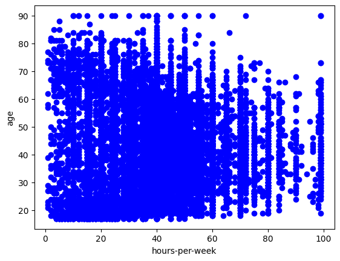

# Project 1 · Adult Census Analysis and PCA

Explore the Adult census dataset and implement principal component analysis directly with NumPy.

## Workflow

1. Load **48,842 records and 15 columns** from `data/adult.csv`.
2. Remove rows containing the categorical missing-value marker `?`.
3. Explore age, weekly working hours, and education using scatter plots, a histogram, a box plot, and a pair plot.
4. One-hot encode object columns and standardize the resulting features.
5. Compute the covariance matrix, eigendecompose it, sort components, and project the data into 10 and then 2 dimensions.
6. Visualize the two-dimensional projection and correlations.

## Open the work

- [Portable notebook](notebooks/adult_income_pca.ipynb)
- [Original submission with outputs](submission/DM-Project1.ipynb)
- [Assignment template](assignment/template.ipynb)
- [Analysis summary](reports/results.md)

Install the repository-level requirements and run cells in order. Dataset paths are resolved automatically from the repository, project, or notebook directory.

## Interpretation

This is exploratory dimensionality reduction, not income prediction. The original implementation encodes all object columns, including `income`. It therefore explores the encoded table rather than a target-excluded predictor matrix. The heatmaps retain the submitted analysis and are not dedicated feature-loading plots.
