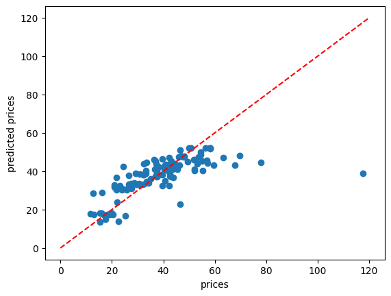

# Project 2 · Real Estate Regression and Association Rules

Two exercises from the same assignment: real-estate price regression and grocery transaction mining.

## Part A · House-price regression

The supplied real-estate CSV contains **414 observations**. The notebook uses house age, distance to the nearest MRT station, and number of convenience stores to predict house price per unit area. It uses a **70/30 train/test split** with `random_state=1`.

Models: linear regression, degree-2 polynomial regression, Ridge, Lasso, Elastic Net, and XGBoost with the **linear booster** (`gblinear`). This is not a boosted-tree experiment.

## Part B · Grocery association rules

The headerless grocery CSV contains **20 transactions**. The submission removes repeated transaction strings, applies `TransactionEncoder`, and uses Apriori with minimum support **0.2**. Association rules are filtered at minimum confidence **0.6**.

## Open the work

- [Portable notebook](notebooks/regression_and_association_rules.ipynb)
- [Original submission with outputs](submission/DM_P2_40023055.ipynb)
- [Original assignment PDF](assignment/assignment.pdf)
- [Assignment template](assignment/template.ipynb)
- [Results and interpretation](reports/results.md)

Install the repository-level requirements and run the notebook in order. Both CSV files are included under `data/`.
