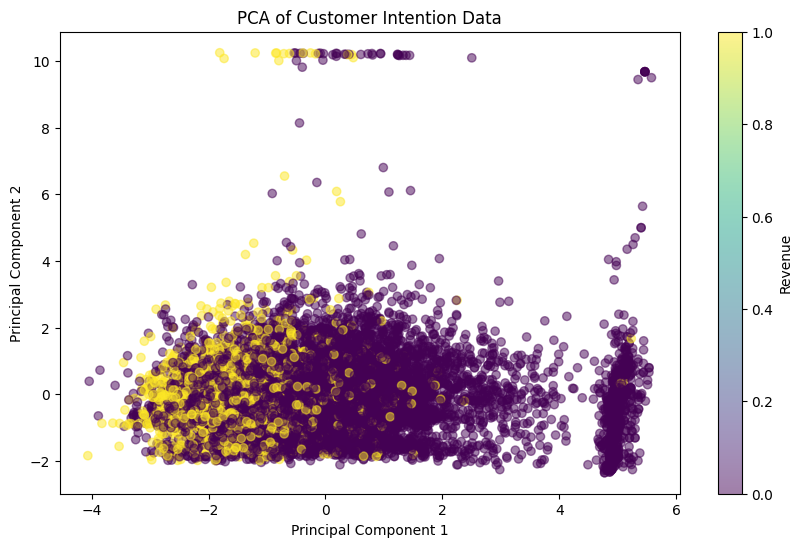

# Project 3 · Online Shopper Purchase Intention

Analyze **12,330 online shopping sessions** with **18 columns**, using `Revenue` as the purchase label.

## Workflow

- Explore label distribution and missing values.
- Apply Box-Cox transformations and label encoding.
- Make a stratified **80/20 train/test split** (`random_state=1`).
- Fit a regression-based classification baseline.
- Visualize PCA and use a six-component representation for classification.
- Apply SMOTE to the training representation.
- Search SVM, KNN, logistic-regression, and decision-tree hyperparameters with five-fold cross-validation.
- Compare classification reports and evaluate a separately configured KNN on the test set.
- Explore K-means and DBSCAN clustering.

## Open the work

- [Portable notebook](notebooks/purchase_intention.ipynb)
- [Original submission with outputs](submission/P3.ipynb)
- [Assignment template](assignment/template.ipynb)
- [Results and evaluation limitations](reports/results.md)

## Running

Install the repository-level requirements. The original logistic-regression and decision-tree grids contain many thousands of fits; a complete run can take a long time. Inspect the preserved submission if you only want to review the historical outputs. The dependency environment retains the older `multi_class` API used by the submitted logistic-regression grid.

For a shorter exploratory run, execute through the PCA section, run the classifier-import cell, and then run the final KNN test cells. The final KNN fit does not depend on SMOTE. This skips grid search and is not an independent reproduction of the complete model-selection process.

## Evaluation context

The saved final KNN report shows approximately **87% test accuracy** but only **37% purchase-class recall**. Do not confuse the training comparison plots or resampled cross-validation scores with held-out performance. See the report for preprocessing leakage, selection, and clustering limitations.
